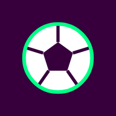
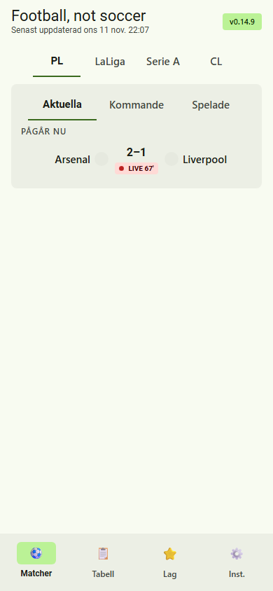
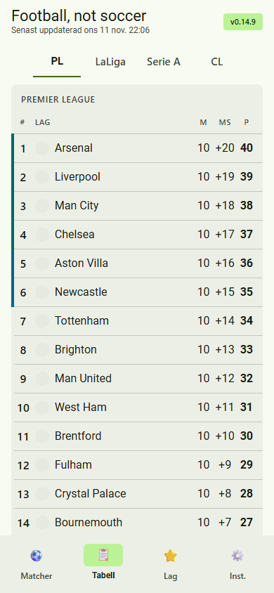
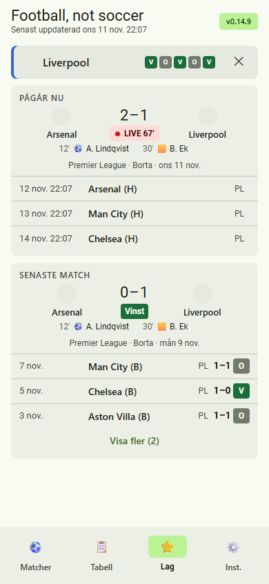
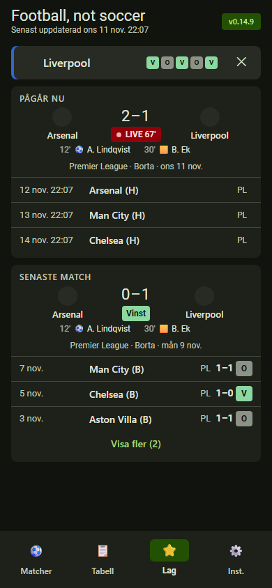

# Football, not soccer ⚽

**Tabellen, matcherna och ditt lag – 16 ligor och turneringar i fickan.**

Inga nyheter, ingen reklam, inget konto. Bara det du vill veta:
*hur ser tabellen ut, vad spelas härnäst och hur gick det för mitt lag?*

### [▶ Öppna appen](https://flyinggooner.github.io/Football-not-soccer/)

[📱 Presentation av appen](https://flyinggooner.github.io/Football-not-soccer/docs/presentation.html) · [🛡️ Små appar, hög nivå](https://flyinggooner.github.io/Football-not-soccer/docs/standard.html)

Påhittade matcher

## Varför?

Fotbollsappar har blivit nyhetsflöden med resultat någonstans längre ner. Den här appen gör tvärtom: öppna den och tabellen, nästa match och senaste resultatet syns direkt – utan att skrolla, utan notiser och utan inloggning. Välj ett lag om du vill följa just det laget.

## Funktioner

| | |
|---|---|
| 🏆 **Matcher** | Flikarna Aktuella, Kommande och Spelade. Svep för att byta flik eller liga. |
| 📋 **Tabell** | Hela tabellen med zoner för Europa och nedflyttning, gruppspel i turneringar. |
| 🌍 **Ligor** | Premier League, LaLiga, Serie A och Champions League som standard – välj bland 16 ligor och turneringar under Inställningar. |
| ⭐ **Lagläge** | Tryck på ett lag i tabellen: nästa match med nedräkning, senaste match med V/O/F, lagets tabellrad och form – i alla turneringar laget spelar i. |
| 🔴 **Live** | Ställning och matchminut, med tilläggstid, uppdateras var 60:e sekund under pågående matcher. |
| ⚽ **Matchdetaljer** | Tryck på en match för målskyttar, straffar, självmål, gula och röda kort. |
| 🔐 **Låst backup** | Spara dina inställningar som en fil som bara ditt lösenord öppnar. |
| 📴 **Offline** | Senast hämtad data visas med tidsstämpel när nätet saknas. |
| 🌗 **Tema** | Ljust och mörkt, följer telefonens inställning. |

## Integritet 🔒

- **Bara en datakälla.** Appen hämtar matchdata direkt från ESPN:s öppna API – inget annat. Ingen analys, inga annonser, inga typsnitt eller skript utifrån. Det spärras även tekniskt med en Content Security Policy.
- **Inget konto, inga cookies.** Valt lag och senast hämtad data sparas bara i din webbläsare (`localStorage`).
- **Ingen spårning åt ESPN.** Appen skickar inget om dig, inte ens sidans adress. ESPN ser, som alla webbplatser, din IP-adress.

> Anrop görs bara när du öppnar appen och under pågående matcher – aldrig i bakgrunden.

### Säkerhetstestad ✅

Automatiska tester körs före varje ny version och varje uppladdning. Underkänt test = ingen release.

**Säkerhetskontroll**
- [x] **Bara appens egen kod körs** – webbläsaren blockerar allt annat.
- [x] **Hämtar bara resultat från ESPN** – skickar inget om dig, och stoppar svar som är för långsamma eller för stora.
- [x] **Din data stannar hos dig** – sparas bara i telefonen; appen rör bara sina egna uppgifter.
- [x] **Fungerar utan nät** – med bara appens egna filer.
- [x] **Låst backup** – bara ditt lösenord öppnar filen. Lösenordet sparas aldrig.

**Funktionstester**
- [x] **Trasiga filer stoppas** – en backup från fel app, eller som någon ändrat i, läses inte in.
- [x] **Inget innehåll kan bli kod** – allt visas som vanlig text.
- [x] **Resultaten kontrolleras** – allt från ESPN granskas innan det visas; det som ser fel ut slängs.
- [x] **Aldrig en blank skärm** – utan nät visas senast hämtade data.
- [x] **Testas utan nät** – testerna använder påhittade matcher.

## Installera på mobilen

**Android (Chrome)**
1. Öppna [appen](https://flyinggooner.github.io/Football-not-soccer/) i Chrome.
2. Tryck på menyn **⋮** → **Installera app** (eller *Lägg till på startskärmen*).

**iPhone (Safari)**
1. Öppna [appen](https://flyinggooner.github.io/Football-not-soccer/) i Safari.
2. Tryck på **Dela** → **Lägg till på hemskärmen**.

Versionsnumret syns uppe till höger i appen. Nya versioner hämtas automatiskt.

## För utvecklare

Ren HTML, CSS och JavaScript – inga ramverk, inga beroenden, inget byggsteg för appen.

**Köra lokalt:** servera mappen statiskt, t.ex. `python3 -m http.server 8080`, och öppna http://localhost:8080 (service workern kräver `localhost` eller HTTPS).

**Testfil:** `tools\build-single.ps1` bakar ihop appen till en enda fil, `dist/football-not-soccer.html`, som går att öppna direkt i webbläsaren eller skicka till någon (utan installation och offline).

| Fil | Innehåll |
|---|---|
| `index.html` | Appens markup |
| `styles.css`, `app.js` | Stil, datakälla och logik |
| `store.js` | Lagring i `localStorage` och validering av sparad data |
| `version.js` | Versionsnummer (enda källan) |
| `sw.js`, `manifest.webmanifest`, `icons/` | Installation som app (PWA) och offline |
| `docs/SPEC.md` | Specifikation av funktioner och beteende |
| `docs/presentation.html` | Fristående mobilpresentation av appen |
| `docs/standard.html` | Små appar, hög nivå – det alla appar har gemensamt (synkas från mallen) |
| `tools/build-single.ps1` | Bygger testfilen |
| `tools/tests/` | Enhets- och flödestester (körs i headless Edge, körs automatiskt före varje release och push) |
| `CLAUDE.md` | Regler för utveckling |

Publiceras till GitHub Pages från `main`.

---
Inofficiellt hobbyprojekt, inte kopplat till Premier League eller ESPN. Det heter fotboll.
