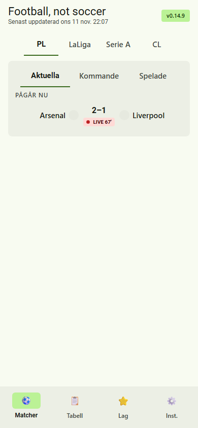
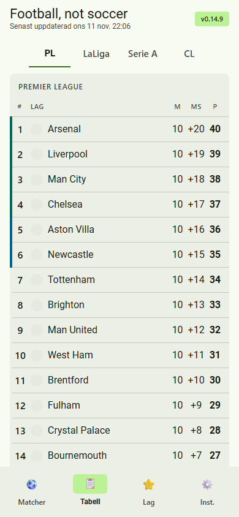
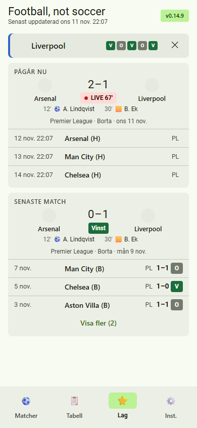
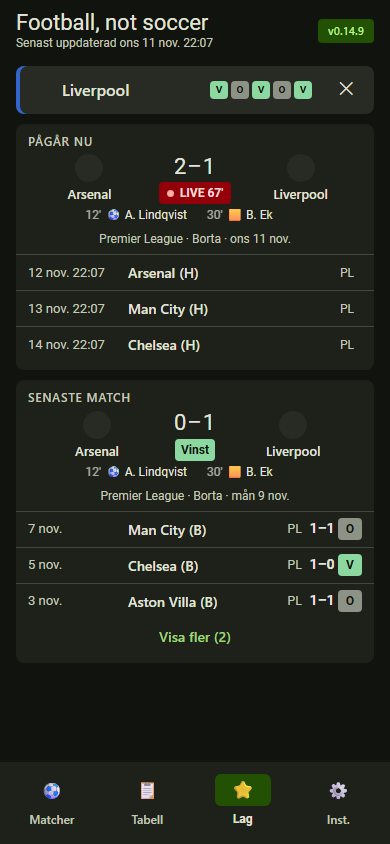

# Football, not soccer ⚽

**The table, the matches and your team – 16 leagues and tournaments in your pocket.**

No news, no ads, no account. Just what you want to know:
*what does the table look like, what is played next and how did my team do?*

### [▶ Open the app](https://flyinggooner.github.io/Football-not-soccer/)

[📱 Presentation of the app](https://flyinggooner.github.io/Football-not-soccer/docs/presentation.html) · [🛡️ Small apps, high standard](https://flyinggooner.github.io/Football-not-soccer/docs/standard.html)

Made-up matches

## Why?

Football apps have become news feeds with results somewhere further down. This app does the opposite: open it and the table, the next match and the latest result show right away – without scrolling, without notifications and without logging in. Choose a team if you want to follow that particular team.

## Features

| | |
|---|---|
| 🏆 **Matches** | The tabs Current, Upcoming and Played. Swipe to change tab or league. |
| 📋 **Table** | The whole table with zones for Europe and relegation, group stages in tournaments. |
| 🌍 **Leagues** | Premier League, LaLiga, Serie A and Champions League by default – choose from 16 leagues and tournaments under Settings. |
| ⭐ **Team mode** | Tap a team in the table: next match with a countdown, latest match with W/D/L, the team's table row and form – in every competition the team plays in. |
| 🔴 **Live** | Score and match minute, with added time, updated every 20 seconds during live matches. |
| ⚽ **Match details** | Tap a match for scorers, penalties, own goals, yellow and red cards. |
| 🌐 **Language** | English or Swedish, chosen at the first start and changeable in Settings. |
| 🔐 **Locked backup** | Save your settings as a file only your password opens. |
| 📴 **Offline** | The latest fetched data is shown with a timestamp when there is no network. |
| 🌗 **Theme** | Light and dark, follows the phone's setting. |

## Why your data is safer here 🛡️

This app holds only which teams you follow – but even that is nobody else's business. Here is why that is safer than in a typical app:

**Hacked company database** – the most common way sensitive data leaks

- Typical app with an account: Your data sits in a database with millions of others – a prime target
- **This app:** There is no database. Your settings are only in your phone, so an attacker would have to get into *your* phone

**Your data is sold or shared**

- Typical app with an account: Common in free apps, and many paid ones share with partners for ads and analytics
- **This app:** No account, no analytics, no ads, no trackers – and the browser technically blocks every request out except match results from ESPN

**Employees or partners read it**

- Typical app with an account: Possible – the company holds the data
- **This app:** Nobody but you has it

**The company shuts down or is sold**

- Typical app with an account: Your data goes with it
- **This app:** The app and your data stay on your phone

**Backup in the cloud**

- Typical app with an account: Readable by the company
- **This app:** Encrypted with AES-256 and your password before it leaves the phone

**Is it the safest possible way?** For personal data like this, keeping it only on your own device, with no server and an encrypted backup, is as safe as a practical app gets – there is simply nothing central to steal. It is not magic, though: your phone itself must be locked and kept updated, the backup password must be strong, and you trust that the code served from GitHub Pages is the published, reviewed code (it is all open on GitHub for anyone to check).

## Privacy 🔒

- **Only one data source.** The app fetches match data directly from ESPN's open API – nothing else. No analytics, no ads, no fonts or scripts from outside. This is also blocked technically with a Content Security Policy.
- **No account, no cookies.** The chosen team and the latest fetched data are stored only in your browser (`localStorage`).
- **No tracking for ESPN.** The app sends nothing about you, not even the page's address. ESPN, like every website, sees your IP address.

> Requests are made only when you open the app and during live matches – never in the background.

### Security tested ✅

Automatic tests run before every new version and every upload. Failed test = no release.

**Security check**
- [x] **Only the app's own code runs** – the browser blocks everything else.
- [x] **Only fetches results from ESPN** – sends nothing about you, and stops responses that are too slow or too large.
- [x] **Your data stays with you** – stored only in the phone; the app only touches its own data.
- [x] **Works offline** – with only the app's own files.
- [x] **Locked backup** – only your password opens the file. The password is never stored in the file.

**Function tests**
- [x] **Broken files are stopped** – a backup from the wrong app, or one someone has changed, is not restored.
- [x] **No content can become code** – everything is shown as plain text.
- [x] **The results are checked** – everything from ESPN is checked before it is shown; anything that looks wrong is thrown away.
- [x] **Never a blank screen** – without network the latest fetched data is shown.
- [x] **Tested without network** – the tests use made-up matches.

## Install on your phone

**Android (Chrome)**
1. Open [the app](https://flyinggooner.github.io/Football-not-soccer/) in Chrome.
2. Tap the menu **⋮** → **Install app** (or *Add to Home screen*).

**iPhone (Safari)**
1. Open [the app](https://flyinggooner.github.io/Football-not-soccer/) in Safari.
2. Tap **Share** → **Add to Home Screen**.

The version number is shown at the top right of the app. New versions are fetched automatically.

## For developers

Plain HTML, CSS and JavaScript – no frameworks, no dependencies, no build step for the app.

**Run locally:** serve the folder statically, e.g. `python3 -m http.server 8080`, and open http://localhost:8080 (the service worker needs `localhost` or HTTPS).

**Test file:** `tools\build-single.ps1` bakes the app into a single file, `dist/football-not-soccer.html`, which can be opened directly in the browser or sent to someone (without installation and offline).

| File | Contents |
|---|---|
| `index.html` | The app's markup |
| `styles.css`, `app.js` | Style, data source and logic |
| `store.js` | Storage in `localStorage` and validation of saved data |
| `i18n.js`, `i18n-en.js` | Language support: the source text is Swedish; `i18n.js` (shared by all apps) translates what is drawn with the dictionary in `i18n-en.js` |
| `version.js` | Version number (single source) |
| `sw.js`, `manifest.webmanifest`, `icons/` | Installation as an app (PWA) and offline |
| `docs/SPEC.md` | Specification of features and behaviour |
| `docs/MANUAL.md`, `docs/MANUAL.en.md` | The manual in Swedish and English (the same text as Help in the app) |
| `docs/presentation.html` | Stand-alone mobile presentation of the app (English by default, Swedish with the button on the first slide) |
| `docs/standard.html` | Small apps, high standard – what all the apps have in common (synced from the template) |
| `tools/build-single.ps1` | Builds the test file |
| `tools/tests/` | Unit and flow tests (run in headless Edge, automatically before every release and push) |
| `CLAUDE.md` | Rules for development |

Published to GitHub Pages from `main`.

---
Unofficial hobby project, not affiliated with the Premier League or ESPN. It is called football.
