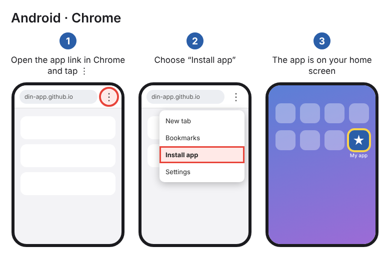
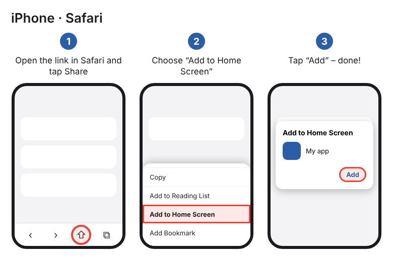

# Football, not soccer – how to use the app

The same text is in the app under **Settings → General → Help and manual** when English is chosen. If one changes: change the other (`card-help-en` in `index.html`; Swedish: `MANUAL.md` and `card-help`).

## Matches and table

- Choose Premier League, LaLiga, Serie A or Champions League with the buttons at the top. Under Matches you first see live and today's matches, then Upcoming and Played as collapsed rows – tap to expand (Show more under each), under Table the whole table.
- The list fills the screen. Show more shows more matches and fetches another week when needed.

## Why your data is safe here
- This app holds which teams you follow – not very sensitive, but nobody else's business. That should not end up with a company, an advertiser or a hacker.
- **No server to hack.** Most big leaks happen when a company's database with millions of users' data is hacked. There is no such database here: your settings are only in your phone. Anyone who wants it has to get into your particular phone.
- **Nothing to sell.** Many free apps – and paid ones too – make money from your data or share it with partners for ads and analytics. This app has no account, no analytics, no ads and no trackers. The browser also technically blocks every request out except the results from ESPN, so the data cannot be sent anywhere, not even by mistake.
- **Locked backup.** The backup file is encrypted with AES-256 and your password. If you put it in the cloud, the cloud service only sees unreadable data.
- **Open code.** All the code is public on GitHub and can be reviewed by anyone.
- **Honestly: nothing is 100 % safe.** What remains is your own phone – lock it with a code and keep it updated – a weak backup password, and that the app's code on GitHub Pages is not changed by someone unauthorised. But for this kind of data there is no safer practical way than never letting it leave the phone.

## Follow a team

- Choose teams (under Following, Favourite or Settings → Teams) shows the leagues. Tap a league, then + to follow a team and ☆ to make it your favourite. If you tap a team in the table it is shown as under Favourite – there you follow it with + and make it your favourite with ☆. At most eight teams can be followed.
- Favourite (in the middle of the menu) shows the favourite team's next and latest match in all competitions and the form in the last five league matches. Show more opens more matches. The app opens on the same tab next time.

## Following

- Following shows all followed teams: at the top the badges (tap to show only one team), live matches and a card per team with the upcoming and latest played match. Tap a team name anywhere in the app (table, matches, team card) to see the team as under Favourite. ← in the team row (or Back) takes you back where you were. Back goes through the tabs you have visited; the app closes only where you started. Tap Upcoming or Played for more matches. Under Settings → Teams ★ makes a team your favourite and ✕ stops following it.

## Move cards

- Under Settings → Appearance → Leagues and card order you choose which leagues and competitions show in the league picker and in which order, and the order of the cards under Favourite. ↑ ↓ moves, ● shows and ○ hides. Reset restores the default.
- There are Premier League, LaLiga, Serie A, Bundesliga, Ligue 1, Eredivisie, Primeira Liga, Allsvenskan, Champions League, Europa League, Conference League, World Cup, Euros, Copa América, Africa Cup of Nations and Gold Cup. Swipe sideways on Matches or Table to change league.

## Matches and live

- Tap a played match to see the scorers, and a live one to also see yellow and red cards. During a live match the score updates every 20 seconds while the app is open. Other data is only fetched again when a match has started.

## Language

- The app starts in Swedish. Change the language under Settings → General → Language. Team and league names come from ESPN and are the same in both languages.

## Offline and data

- The latest fetched data is saved and shown offline, with the time of the latest update. Match data is fetched from ESPN directly from your device. ESPN sees your IP address and which leagues and teams are fetched, but no account and no cookies.
- Under Settings → Data you save an encrypted backup file with followed teams, favourite and league. Match data is not included, it is fetched again.
- The backup file is always locked with **your code**: 16 random characters the app creates for you the first time it starts and stores on the device. If you would rather use your own code (e.g. the same in all your apps), tap **Choose your own code** – it needs at least 16 characters with upper and lower case, a digit and a special character, the same requirements as the created one. A backup takes one tap. Under Settings → Data you find Your code: **Show**, **Copy** and **New code**. Save the code in your password manager – on a new phone (or after Delete all data) you need it to open a backup. If you restore a backup with a different code, that code is used for new backups from then on. New code means old backup files open only with the old code (Undo is available). The app collects no data – the code is just a key that protects your backups.

## Install as an app

- **Android (Chrome):** open the app link, tap ⋮ at the top right and choose **Install app**.

- **iPhone (Safari):** open the link in Safari, tap **Share** (the box with the arrow) and choose **Add to Home Screen** → **Add**.
- Installed, the app works like a normal app, even offline.
