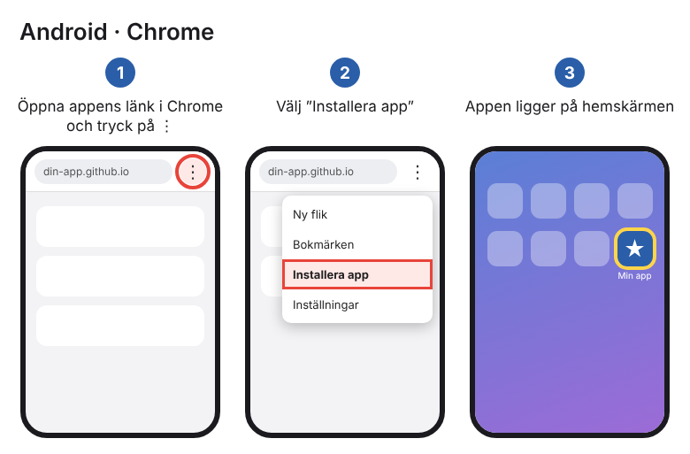
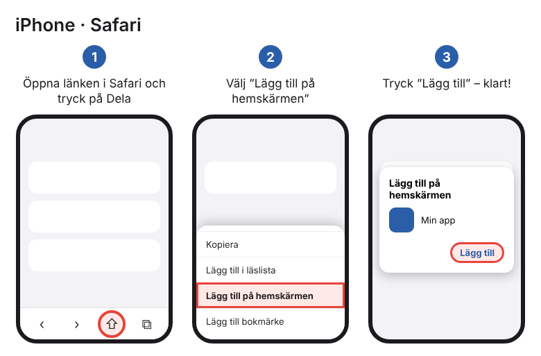

# Football, not soccer – så använder du appen

Samma text finns i appen under **Inställningar → Allmänt → Hjälp och manual**. Ändras den ena: ändra den andra (`card-help` i `index.html`).

## Matcher och tabell

- Välj Premier League, LaLiga, Serie A eller Champions League med knapparna överst. Under Matcher står först pågående och dagens matcher, sedan Kommande och Spelade som hopfällda rader – tryck för att fälla ut (Visa fler under var och en), under Tabell hela tabellen.
- Listan fyller skärmen. Visa fler visar fler matcher och hämtar en vecka till när det behövs.

## Varför din data är säker här
- Här finns vilka lag du följer – inte så känsligt, men ingen annans sak. Sådant ska inte hamna hos ett företag, en annonsör eller en hackare.
- **Ingen server att hacka.** De flesta stora läckor sker när ett företags databas med miljontals användares uppgifter hackas. Här finns ingen sådan databas: dina inställningar finns bara i din telefon. Den som vill åt den måste komma åt just din telefon.
- **Inget att sälja.** Många gratisappar – och även betalappar – tjänar pengar på din data eller delar den med partner för annonser och analys. Den här appen har inget konto, ingen analys, ingen reklam och inga spårare. Webbläsaren spärrar dessutom tekniskt alla anrop ut utom resultaten från ESPN, så datan kan inte skickas iväg ens av misstag.
- **Låst backup.** Backup-filen krypteras med AES-256 och ditt lösenord. Lägger du den i molnet ser molntjänsten bara obegriplig data.
- **Öppen kod.** All kod ligger öppet på GitHub och kan granskas av vem som helst.
- **Ärligt: inget är 100 % säkert.** Det som återstår är din egen telefon – lås den med kod och håll den uppdaterad – ett svagt backup-lösenord, och att appens kod på GitHub Pages inte ändras av någon obehörig. Men för den här sortens uppgifter finns inget säkrare praktiskt sätt än att de aldrig lämnar telefonen.

## Följa ett lag

- Välj lag (under Följer, Favorit eller Inställningar → Lag) visar ligorna. Tryck på en liga, sedan + för att följa ett lag och ☆ för att göra det till favorit. Trycker du på ett lag i tabellen visas laget som under Favorit – där följer du det med + och gör det till favorit med ☆. Högst åtta lag kan följas.
- Favorit (mitten i menyn) visar favoritlagets nästa och senaste match i alla turneringar och formen i de fem senaste ligamatcherna. Visa fler fäller ut fler matcher. Appen öppnas på samma flik nästa gång.

## Följer

- Följer visar alla följda lag: överst märkena (tryck för att bara visa ett lag), pågående matcher och ett kort per lag med kommande och senast spelade match. Tryck på ett lagnamn var som helst i appen (tabell, matcher, lagkort) för att se laget som under Favorit. ← i lagraden (eller Bakåt) tar dig tillbaka dit du var. Bakåt går genom flikarna du besökt; appen stängs först där du började. Tryck på Kommande eller Spelad för fler matcher. Under Inställningar → Lag gör ★ ett lag till favorit och ✕ slutar följa det.

## Flytta kort

- Under Inställningar → Utseende → Ligor och kortordning väljer du vilka ligor och turneringar som visas i ligaväljaren och i vilken ordning, och ordningen på korten under Favorit. ↑ ↓ flyttar, ● visar och ○ döljer. Återställ ger standard.
- Det finns Premier League, LaLiga, Serie A, Bundesliga, Ligue 1, Eredivisie, Primeira Liga, Allsvenskan, Champions League, Europa League, Conference League, VM, EM, Copa América, Afrikanska mästerskapen och Gold Cup. Svep i sidled på Matcher eller Tabell för att byta liga.

## Matcher och live

- Tryck på en spelad match för att se målskyttarna, på en pågående även gula och röda kort. Under pågående match uppdateras ställningen var 20:e sekund medan appen är öppen. Övrig data hämtas bara igen när en match har börjat.

## Språk

- Appen är på svenska från början. Byt språk under Inställningar → Allmänt → Språk. Lag- och liganamn kommer från ESPN och är desamma på båda språken.

## Offline och data

- Senast hämtad data sparas och visas utan nät, med tid för senaste uppdatering. Matchdata hämtas från ESPN direkt från din enhet. ESPN ser din IP-adress och vilka ligor och lag som hämtas, men inget konto och inga cookies.
- Under Inställningar → Data sparar du en krypterad backup-fil med följda lag, favorit och liga. Matchdata ingår inte, den hämtas igen.
- Backup-filen låses alltid med **din kod**: 16 slumpade tecken som appen skapar åt dig första gången den startas och sparar på enheten. Vill du hellre använda en egen kod (t.ex. samma i alla dina appar) trycker du **Välj egen kod** – den måste ha minst 16 tecken med stor och liten bokstav, siffra och specialtecken, samma krav som den skapade. Backup sparas med ett tryck. Under Inställningar → Data finns Din kod: **Visa**, **Kopiera** och **Ny kod**. Spara koden i din lösenordshanterare – på en ny telefon (eller efter Radera all data) behöver du den för att öppna en backup. Läser du in en backup med en annan kod används den koden sedan för nya backuper. Ny kod gör att gamla backup-filer bara öppnas med den gamla koden (Ångra finns). Appen samlar ingen data – koden är bara en nyckel som skyddar dina backuper.

## Installera som app

- **Android (Chrome):** öppna appens länk, tryck ⋮ uppe till höger och välj **Installera app**.

- **iPhone (Safari):** öppna länken i Safari, tryck **Dela** (rutan med pilen) och välj **Lägg till på hemskärmen** → **Lägg till**.
- Installerad fungerar appen som en vanlig app, även utan nät.
